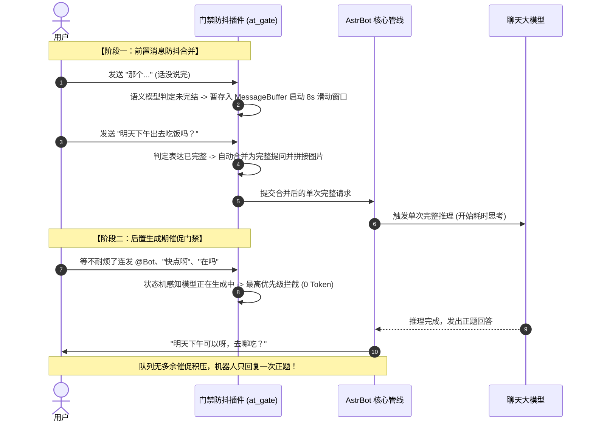

<h1 align="center">智能艾特门禁与消息防抖 (at_gate)</h1>

<p align="center">前置碎句智能合并，后置多次@与生成期催促静默收敛，全生命周期守护对话节奏。</p>

<p align="center">
  
  
  
  <a href="LICENSE"></a>
</p>

<p align="center">
  <a href="#它解决什么痛点">解决痛点</a> ·
  <a href="#核心特性">核心特性</a> ·
  <a href="#双阶段工作原理">工作原理</a> ·
  <a href="#运行模式与模型兼容">模型兼容</a> ·
  <a href="#快速开始">快速开始</a> ·
  <a href="#配置项全览">配置项全览</a> ·
  <a href="#常见问题-faq">常见问题</a>
</p>

---

## 它解决什么痛点

在群聊与私聊日常交互中，有两大破坏体验的常见高频场景：

1. **碎句抢答与连续触发（前置痛点）**：
   - 用户习惯分多次发送一句话（例如：*“那个”* → *“明天下午”* → *“有空去吃饭吗？”*）；
   - 普通机器人每句都单独回复一次，导致答非所问、疯狂插话、打断用户思考且浪费多倍 Token。

2. **生成等待期连点催促与排队连回（后置痛点）**：
   - 当机器人遇到耗时较长的长任务（如画图、联网搜索、深度长文生成 15~50 秒）时，用户因等待焦虑而连续连点 `@机器人`、发送纯空 `@` 或催促短语（*“？”*、*“在吗”*、*“快点啊”*）；
   - AstrBot 框架核心的 `follow_up` 队列会将这些等待期消息暂存排队；
   - **当机器人回答完正题后，核心队列依次被唤醒，导致机器人接着连发多次机械式问候（“在的哦～/叫我吗？”）**，显得极其呆滞低智。

**本插件（`at_gate`）将「前置消息防抖」与「后置生成期门禁」融为一体，彻底解决上述两大顽疾。**

---

## 核心特性

- **双阶段守护管线**：前置拦截碎句抢答，后置阻断生成期连发催促；
- **真实图文多模态合并**：文字拼接、连续重复内容抑制，多张图片组件自动去重合并；
- **全平台原生兼容**：鸭子类型设计，无缝支持 OneBot (QQ)、QQ 官方 Webhook、飞书、企业微信与 Telegram；
- **四层自适应决策引擎**：
  - **零配置模式**：留空即可直接复用 AstrBot 主会话已配置的默认大模型；
  - **自主模型选择**：支持在配置中指定 AstrBot 内部已有的任意 Provider ID；
  - **TypeSafe JEV 协议**：支持官方及 OpenRouter 原生 System One `/systemone` Noul 概率计算；
  - **通用大模型协议**：支持任何遵循 OpenAI 格式的第三方平台（硅基流动、DeepSeek、聚合中转等）；
  - **离线规则兜底**：网络故障或无模型时，毫秒级 0 Token 状态机兜底，绝不卡死聊天；
- **极速轻量**：移除了原版 debounce 对 `onnxruntime` 等数百兆庞大二进制包的依赖，轻量秒级装载。

---

## 双阶段工作原理



---

## 运行模式与模型兼容

针对 AstrBot Cloud 与各类部署环境，插件提供了极佳的普适性：

| 模式 | 配置方式 | 协议类型 | 推荐场景 |
| :--- | :--- | :--- | :--- |
| **A. 零配置模式（默认推荐）** | `jev_api_key` 留空，`astrbot_provider_id` 留空 | 复用 AstrBot 默认模型 | **普通用户一键开箱即用**，不需要额外申请 Key 或花钱 |
| **B. 指定 AstrBot 内部模型** | 填写 `astrbot_provider_id`（如 `siliconflow`、`火山` 等） | AstrBot 原生 Provider 接口 | 适合想用 AstrBot 后台已配置的某个特定便宜小模型 |
| **C. 专用极速大模型** | 填第三方 `jev_base_url`、`jev_api_key` 与 `jev_model` | OpenAI Chat Completions | **国内免梯子极力推荐**：如硅基流动 `Qwen/Qwen2.5-7B-Instruct`（0.9s响应且免费） |
| **D. TypeSafe JEV 官方/托管** | 填 OpenRouter 或 TypeSafe 的 Key，模型填 `typesafe/jev-1.14` | System One `/systemone` | 原生 Noul 概率计算，百毫秒级极速决策 |
| **E. 纯离线规则兜底** | 关闭 `use_jev` | 本地状态机与词库规则 | 0 API 开销，0 延迟，纯本地规则守护 |

---

## 快速开始

### 安装方式

#### 方式一：AstrBot WebUI 插件市场安装（推荐）
1. 打开 AstrBot WebUI 面板；
2. 进入「插件管理」页面；
3. 搜索 `astrbot_plugin_at_gate` 点击安装并重载即可。

#### 方式二：手动克隆安装
进入 AstrBot 插件目录执行克隆：
```bash
cd AstrBot/data/plugins
git clone https://github.com/Meru-tea/astrbot_plugin_at_gate.git
```
安装后重载插件或重启 AstrBot 容器生效。

---

## 配置项全览

在 AstrBot WebUI「插件管理 → 智能艾特门禁与消息防抖 → 插件配置」中可视化调整：

| 配置项 | 默认值 | 说明 |
| :--- | :---: | :--- |
| `enabled` | `true` | **后置艾特门禁总开关**（生成期防催促与多次@收敛） |
| `enable_debounce` | `true` | **前置消息防抖总开关**（碎句智能合并） |
| `debounce_timeout` | `8.0` | 碎句未说完时的最大等待秒数（超时自动合并发送） |
| `debounce_threshold` | `0.8` | 句子完整度判定置信度阈值（0.0 ~ 1.0） |
| `usage_scope` | `both` | 防抖生效范围（`both` 群聊与私聊 / `group` 仅群聊 / `private` 仅私聊） |
| `use_jev` | `true` | 是否启用语义意图与完整度模型决策 |
| `astrbot_provider_id` | `空` | 指定使用 AstrBot 内部已配置的模型 ID（留空使用默认主模型） |
| `astrbot_model_name` | `空` | 可选覆盖 AstrBot 内部模型的具体名称 |
| `jev_api_key` | `空` | 独立第三方模型 API Key（留空则自动走 AstrBot 内部模型） |
| `jev_base_url` | `https://api.typesafe.ai/v1` | 独立模型接口地址（支持 OpenRouter, 硅基流动, DeepSeek 等） |
| `jev_model` | `jev-latest` | 模型名称（非 JEV 会自动切换为 Chat Completions 协议） |
| `jev_threshold` | `0.5` | 多次 @ 判定需要回复的置信度阈值 |
| `jev_timeout_seconds` | `10.0` | 独立模型单次请求超时秒数（超时自动无缝降级走规则兜底） |
| `suppress_empty_at` | `true` | 是否静默拦截短时间内的纯空 @ |
| `suppress_during_active_run` | `true` | 生成期间是否抑制催促词与空 @ 连点 |
| `cooldown_after_reply_sec` | `5` | 回复发出后的保护期秒数（拦截网络延迟到达的空 @） |
| `allow_distinct_questions` | `true` | 规则兜底模式下是否放行明显的新提问 |
| `log_intercept` | `true` | 是否在日志中打印详细的拦截原因与统计 |

---

## 管理与诊断指令

- `/atgate`：查看当前门禁、防抖运行状态、模型决策统计与拦截明细（**仅管理员可用**）。

输出示例：
```text
🛡️ 【智能艾特门禁与消息防抖 v1.0.0 运行状态】
• 门禁开关: 开启
• 消息防抖: 开启 (超时: 8s, 阈值: 0.8)
• 语义决策: 独立第三方API (Qwen/Qwen2.5-7B-Instruct, 协议=ChatCompletions, 决策调用: 12次)
• 触发阈值: 2 次
• 统计窗口: 30 秒
• 纯空@拦截: 开启
• 生成期抑制: 开启
• 回复保护期: 5 秒
• 门禁拦截总计: 8 次
• 拦截原因细分:
  - chat_rejected(conf=0.95): 5 次
  - empty_at_during_active_run: 3 次
```

---

## 常见问题 (FAQ)

### Q: 装了其他的陪伴插件（如 private_companion），会有冲突吗？
**完全不冲突。**
- 艾特门禁工作在最高优先级（`priority=999`），旨在保护下游插件在生成时不被核心队列的空 @ 骚扰唤醒，且完全不影响下游插件的分段回复与表情包出站；
- 本插件的前置防抖与艾特门禁功能完全独立，若下游插件自身开启了防抖，可随时在面板中将 `enable_debounce` 单独关闭。

### Q: 我没有 JEV 账号，能用吗？
**完全可以。**
保持 `jev_api_key` 留空即可！插件会自动复用你在 AstrBot 后台已经配好的大模型进行意图判定，无需花一分钱或填写额外密钥。

---

## 开源协议

本项目采用 [MIT License](LICENSE) 许可协议。
